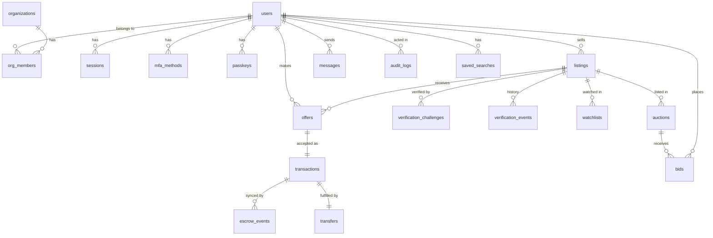

# DomainFolio — Database Schema (draft, P0)

| Field | Value |
|---|---|
| Status | **Phase 1 draft — for Spencer's review. Tables land one Alembic revision per P0 stage; this doc is the target, not the current DB.** |
| Database | PostgreSQL 16. UUID primary keys (`gen_random_uuid()`). All timestamps `timestamptz`. Money in integer cents. |
| Rules | Migrations only (Alembic). No `CREATE TABLE IF NOT EXISTS` in app code. Soft-delete nothing that money touched — transactions and audit rows are append-only. |

## 1. Entity overview



## 2. Tables

### 2.1 Identity — `users`, `organizations`, `org_members`, `sessions`, `mfa_methods`, `passkeys`

```sql
users (
  id            uuid PK DEFAULT gen_random_uuid(),
  email         citext NOT NULL UNIQUE,          -- case-insensitive
  password_hash text NOT NULL,                   -- bcrypt
  display_name  text,
  role          text NOT NULL DEFAULT 'user'     -- user | broker | admin
                CHECK (role IN ('user','broker','admin')),
  email_verified_at timestamptz,
  suspended_at  timestamptz,
  suspension_reason text,
  created_at    timestamptz NOT NULL DEFAULT now(),
  updated_at    timestamptz NOT NULL DEFAULT now()
);

organizations (
  id         uuid PK DEFAULT gen_random_uuid(),
  name       text NOT NULL,
  owner_id   uuid NOT NULL REFERENCES users(id),
  created_at timestamptz NOT NULL DEFAULT now()
);

org_members (
  org_id     uuid NOT NULL REFERENCES organizations(id) ON DELETE CASCADE,
  user_id    uuid NOT NULL REFERENCES users(id) ON DELETE CASCADE,
  role       text NOT NULL CHECK (role IN ('owner','admin','member')),
  created_at timestamptz NOT NULL DEFAULT now(),
  PRIMARY KEY (org_id, user_id)
);

sessions (                                -- server-side, revocable
  id            uuid PK DEFAULT gen_random_uuid(),
  user_id       uuid NOT NULL REFERENCES users(id) ON DELETE CASCADE,
  token_hash    text NOT NULL,            -- only the hash is stored
  user_agent    text,
  ip_address    inet,
  created_at    timestamptz NOT NULL DEFAULT now(),
  expires_at    timestamptz NOT NULL,
  revoked_at    timestamptz
);
CREATE INDEX ix_sessions_user ON sessions(user_id);
CREATE INDEX ix_sessions_token ON sessions(token_hash);

mfa_methods (                             -- TOTP (passkeys separate)
  id          uuid PK DEFAULT gen_random_uuid(),
  user_id     uuid NOT NULL REFERENCES users(id) ON DELETE CASCADE,
  type        text NOT NULL DEFAULT 'totp' CHECK (type IN ('totp')),
  secret_enc  bytea NOT NULL,             -- encrypted at rest
  verified_at timestamptz,
  created_at  timestamptz NOT NULL DEFAULT now()
);

passkeys (                                -- WebAuthn credentials
  id              uuid PK DEFAULT gen_random_uuid(),
  user_id         uuid NOT NULL REFERENCES users(id) ON DELETE CASCADE,
  credential_id   bytea NOT NULL UNIQUE,
  public_key      bytea NOT NULL,
  sign_count      bigint NOT NULL DEFAULT 0,
  transports      text[],
  created_at      timestamptz NOT NULL DEFAULT now(),
  last_used_at    timestamptz
);
```

### 2.2 Listings — `domains`, `listings`

`domains` is the normalized name registry (one row per distinct
domain, ever listed); `listings` is the sellable record. A domain can
have at most one active listing — enforced by a partial unique index,
not by application code.

```sql
domains (
  id           uuid PK DEFAULT gen_random_uuid(),
  name         text NOT NULL UNIQUE,      -- normalized: lowercase, punycode, no trailing dot
  tld          text NOT NULL,             -- derived at insert
  length       int NOT NULL,              -- name length without TLD, for filters
  created_at   timestamptz NOT NULL DEFAULT now()
);

listings (
  id              uuid PK DEFAULT gen_random_uuid(),
  domain_id       uuid NOT NULL REFERENCES domains(id),
  seller_id       uuid NOT NULL REFERENCES users(id),
  org_id          uuid REFERENCES organizations(id),
  status          text NOT NULL DEFAULT 'draft'
                  CHECK (status IN ('draft','pending_verification','active',
                                    'reserved','sold','expired','suspended')),
  price_cents     bigint,                 -- NULL = make-an-offer only
  min_offer_cents bigint,                 -- enforced server-side (audit bug fix)
  negotiable      boolean NOT NULL DEFAULT true,
  category        text,
  tagline         text,
  description     text,
  lease_months    int CHECK (lease_months IS NULL OR lease_months > 0),
  featured_until  timestamptz,            -- paid placement; NULL = not featured
  expires_at      timestamptz,
  created_at      timestamptz NOT NULL DEFAULT now(),
  updated_at      timestamptz NOT NULL DEFAULT now()
);
CREATE UNIQUE INDEX ix_listings_one_active
  ON listings(domain_id) WHERE status IN ('active','reserved','pending_verification');
CREATE INDEX ix_listings_status ON listings(status);
CREATE INDEX ix_listings_seller ON listings(seller_id);
CREATE INDEX ix_listings_price ON listings(price_cents);
```

### 2.3 Verification — `verification_challenges`, `verification_events`

```sql
verification_challenges (
  id            uuid PK DEFAULT gen_random_uuid(),
  listing_id    uuid NOT NULL REFERENCES listings(id) ON DELETE CASCADE,
  token         text NOT NULL UNIQUE,     -- random; shown once to the seller
  token_hash    text NOT NULL,            -- only the hash is stored
  method        text NOT NULL DEFAULT 'dns_txt' CHECK (method IN ('dns_txt')),
  status        text NOT NULL DEFAULT 'pending'
                CHECK (status IN ('pending','verified','expired','revoked','failed')),
  attempts      int NOT NULL DEFAULT 0,
  expires_at    timestamptz NOT NULL,     -- short-lived (e.g. 72h)
  verified_at   timestamptz,
  created_at    timestamptz NOT NULL DEFAULT now()
);
CREATE INDEX ix_verif_listing ON verification_challenges(listing_id);

verification_events (                     -- append-only history
  id            uuid PK DEFAULT gen_random_uuid(),
  listing_id    uuid NOT NULL REFERENCES listings(id) ON DELETE CASCADE,
  challenge_id  uuid REFERENCES verification_challenges(id),
  event         text NOT NULL,            -- requested | checked | verified |
                                           -- expired | revoked | reverify_due |
                                           -- ownership_change_suspected
  detail        jsonb NOT NULL DEFAULT '{}'::jsonb,
  created_at    timestamptz NOT NULL DEFAULT now()
);
```

### 2.4 Offers — `offers`

```sql
offers (
  id              uuid PK DEFAULT gen_random_uuid(),
  listing_id      uuid NOT NULL REFERENCES listings(id),
  buyer_id        uuid NOT NULL REFERENCES users(id),
  amount_cents    bigint NOT NULL CHECK (amount_cents > 0),
  message         text,
  status          text NOT NULL DEFAULT 'open'
                  CHECK (status IN ('open','countered','accepted','rejected',
                                    'expired','withdrawn')),
  parent_offer_id uuid REFERENCES offers(id),   -- counteroffer chain
  expires_at      timestamptz NOT NULL,
  created_at      timestamptz NOT NULL DEFAULT now(),
  updated_at      timestamptz NOT NULL DEFAULT now()
);
CREATE INDEX ix_offers_listing ON offers(listing_id);
CREATE INDEX ix_offers_buyer ON offers(buyer_id);
```

### 2.5 Transactions & escrow — `transactions`, `escrow_events`, `commission_versions`, `commissions`

```sql
transactions (
  id              uuid PK DEFAULT gen_random_uuid(),
  listing_id      uuid NOT NULL REFERENCES listings(id),
  offer_id        uuid REFERENCES offers(id),       -- NULL for Buy Now
  buyer_id        uuid NOT NULL REFERENCES users(id),
  seller_id       uuid NOT NULL REFERENCES users(id),
  domain          text NOT NULL,                    -- denormalized for the record
  sale_cents      bigint NOT NULL CHECK (sale_cents > 0),
  currency        text NOT NULL DEFAULT 'USD',
  status          text NOT NULL DEFAULT 'created'
                  CHECK (status IN ('created','payment_pending','payment_secured',
                                    'transfer_initiated','transfer_confirmed',
                                    'settled','refunded','disputed','cancelled')),
  escrow_provider text NOT NULL DEFAULT 'stub',
  escrow_ref      text,                             -- provider reference
  commission_version_id uuid REFERENCES commission_versions(id),
  commission_cents bigint,
  created_at      timestamptz NOT NULL DEFAULT now(),
  updated_at      timestamptz NOT NULL DEFAULT now()
);
CREATE INDEX ix_tx_buyer ON transactions(buyer_id);
CREATE INDEX ix_tx_seller ON transactions(seller_id);
CREATE INDEX ix_tx_status ON transactions(status);
CREATE UNIQUE INDEX ix_tx_escrow_ref
  ON transactions(escrow_provider, escrow_ref) WHERE escrow_ref IS NOT NULL;

escrow_events (                            -- append-only; idempotency key
  id              uuid PK DEFAULT gen_random_uuid(),
  transaction_id  uuid NOT NULL REFERENCES transactions(id) ON DELETE CASCADE,
  provider_event_id text NOT NULL,         -- dedup key from the provider
  event_type      text NOT NULL,
  payload         jsonb NOT NULL,
  received_at     timestamptz NOT NULL DEFAULT now(),
  UNIQUE (transaction_id, provider_event_id)
);

commission_versions (                      -- rates are versioned, never edited
  id               uuid PK DEFAULT gen_random_uuid(),
  version          int NOT NULL UNIQUE,
  standard_pct     numeric(5,2) NOT NULL,  -- e.g. 10.00
  high_volume_pct  numeric(5,2) NOT NULL,  -- e.g. 8.00
  broker_pct       numeric(5,2) NOT NULL,  -- e.g. 15.00
  effective_from   timestamptz NOT NULL DEFAULT now(),
  created_by       uuid REFERENCES users(id)
);
```

### 2.6 Transfers — `transfers`

```sql
transfers (
  id              uuid PK DEFAULT gen_random_uuid(),
  transaction_id  uuid NOT NULL REFERENCES transactions(id),
  kind            text NOT NULL CHECK (kind IN ('registrar_push','inter_registrar')),
  registrar_from  text,
  registrar_to    text,
  status          text NOT NULL DEFAULT 'not_started'
                  CHECK (status IN ('not_started','auth_requested','in_progress',
                                    'awaiting_buyer','confirmed','failed','cancelled')),
  deadline_at     timestamptz,
  buyer_confirmed_at timestamptz,
  -- Auth codes are NEVER stored in this table or in logs. The code
  -- lives only in the provider handoff / seller's hands.
  evidence        jsonb NOT NULL DEFAULT '{}'::jsonb,  -- status screenshots, ticket ids
  created_at      timestamptz NOT NULL DEFAULT now(),
  updated_at      timestamptz NOT NULL DEFAULT now()
);
```

### 2.7 Auctions (P1) — `auctions`, `bids`

```sql
auctions (
  id              uuid PK DEFAULT gen_random_uuid(),
  listing_id      uuid NOT NULL REFERENCES listings(id),
  seller_id       uuid NOT NULL REFERENCES users(id),
  status          text NOT NULL DEFAULT 'scheduled'
                  CHECK (status IN ('scheduled','live','closed','cancelled')),
  start_price_cents bigint NOT NULL CHECK (start_price_cents > 0),
  reserve_cents   bigint,
  min_increment_cents bigint NOT NULL,
  starts_at       timestamptz NOT NULL,
  ends_at         timestamptz NOT NULL,
  extended_until  timestamptz,             -- anti-sniping extensions
  created_at      timestamptz NOT NULL DEFAULT now()
);

bids (
  id            uuid PK DEFAULT gen_random_uuid(),
  auction_id    uuid NOT NULL REFERENCES auctions(id),
  bidder_id     uuid NOT NULL REFERENCES users(id),
  amount_cents  bigint NOT NULL CHECK (amount_cents > 0),
  -- Server time is authoritative: the DB clock stamps the bid.
  created_at    timestamptz NOT NULL DEFAULT now()
);
CREATE INDEX ix_bids_auction ON bids(auction_id, amount_cents DESC);
```

### 2.8 Buyer tools — `watchlists`, `saved_searches`, `messages`

```sql
watchlists (
  user_id     uuid NOT NULL REFERENCES users(id) ON DELETE CASCADE,
  listing_id  uuid NOT NULL REFERENCES listings(id) ON DELETE CASCADE,
  created_at  timestamptz NOT NULL DEFAULT now(),
  PRIMARY KEY (user_id, listing_id)
);

saved_searches (
  id          uuid PK DEFAULT gen_random_uuid(),
  user_id     uuid NOT NULL REFERENCES users(id) ON DELETE CASCADE,
  name        text NOT NULL,
  query       jsonb NOT NULL,              -- filters as data, not SQL
  notify      boolean NOT NULL DEFAULT false,
  created_at  timestamptz NOT NULL DEFAULT now()
);

messages (                                 -- buyer <-> seller, per transaction
  id              uuid PK DEFAULT gen_random_uuid(),
  transaction_id  uuid REFERENCES transactions(id),
  listing_id      uuid REFERENCES listings(id),
  sender_id       uuid NOT NULL REFERENCES users(id),
  body            text NOT NULL,
  created_at      timestamptz NOT NULL DEFAULT now()
);
CREATE INDEX ix_messages_tx ON messages(transaction_id, created_at);
```

### 2.9 Admin — `audit_logs`, `disputes`, `fraud_alerts`

```sql
audit_logs (                               -- append-only
  id          uuid PK DEFAULT gen_random_uuid(),
  actor_id    uuid REFERENCES users(id),   -- NULL = system
  action      text NOT NULL,               -- e.g. listing.suspend, tx.refund
  target_type text NOT NULL,
  target_id   uuid,
  detail      jsonb NOT NULL DEFAULT '{}'::jsonb,
  ip_address  inet,
  created_at  timestamptz NOT NULL DEFAULT now()
);
CREATE INDEX ix_audit_actor ON audit_logs(actor_id, created_at);
CREATE INDEX ix_audit_target ON audit_logs(target_type, target_id);

disputes (
  id              uuid PK DEFAULT gen_random_uuid(),
  transaction_id  uuid NOT NULL REFERENCES transactions(id),
  raised_by       uuid NOT NULL REFERENCES users(id),
  reason          text NOT NULL,
  status          text NOT NULL DEFAULT 'open'
                  CHECK (status IN ('open','investigating','resolved','closed')),
  resolution      text,
  created_at      timestamptz NOT NULL DEFAULT now(),
  updated_at      timestamptz NOT NULL DEFAULT now()
);

fraud_alerts (
  id              uuid PK DEFAULT gen_random_uuid(),
  listing_id      uuid REFERENCES listings(id),
  user_id         uuid REFERENCES users(id),
  signal          text NOT NULL,           -- e.g. shill_pattern, velocity
  detail          jsonb NOT NULL DEFAULT '{}'::jsonb,
  status          text NOT NULL DEFAULT 'open'
                  CHECK (status IN ('open','reviewed','dismissed')),
  created_at      timestamptz NOT NULL DEFAULT now()
);
```

## 3. Migration strategy

- One Alembic revision per P0 stage (Stage 2 → identity tables,
  Stage 3 → verification, Stage 4 → listings, Stage 6 → offers,
  Stage 7 → transactions/escrow, Stage 8 → transfers, Stage 9 →
  admin tables; auctions in P1, AI tables in P2).
- `0001_initial` (skeleton) holds the minimal `users` + `listings`
  shape so the chain runs end-to-end; it is replaced by the real
  Stage 2 revision content before any production data exists — the
  skeleton never sees production.
- Migrations are append-only. A wrong migration is fixed by a new
  migration, never by editing a merged one.
- Downtime-free rule: additive changes first, code deploy, then
  removal of the old shape in a later revision.

## 4. Lander data note

The four live names currently live in the lander app's SQLite file.
They are **not** migrated into this schema automatically. Migration of
that inventory is part of the cutover decision (master plan §6):
delist-on-sale policy first, data move second, and only with
Spencer's approval.

## 5. Open schema questions (for stage reviews)

1. Multi-currency: `currency` is stored per transaction; FX source
   and settlement currency are decided at Stage 7.
2. `citext` requires the extension — created by the Stage 2
   migration, with a fallback if the managed host forbids it.
3. Meilisearch index shape mirrors `listings` + `domains` (denormalized
   document); defined in Stage 5, not here.
```

---

*Schema draft source: Phase 0 audit + master plan, Option B, 2026-11-23.*
