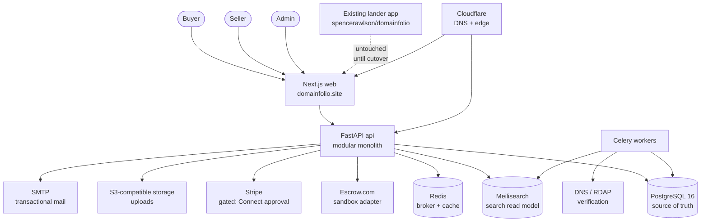
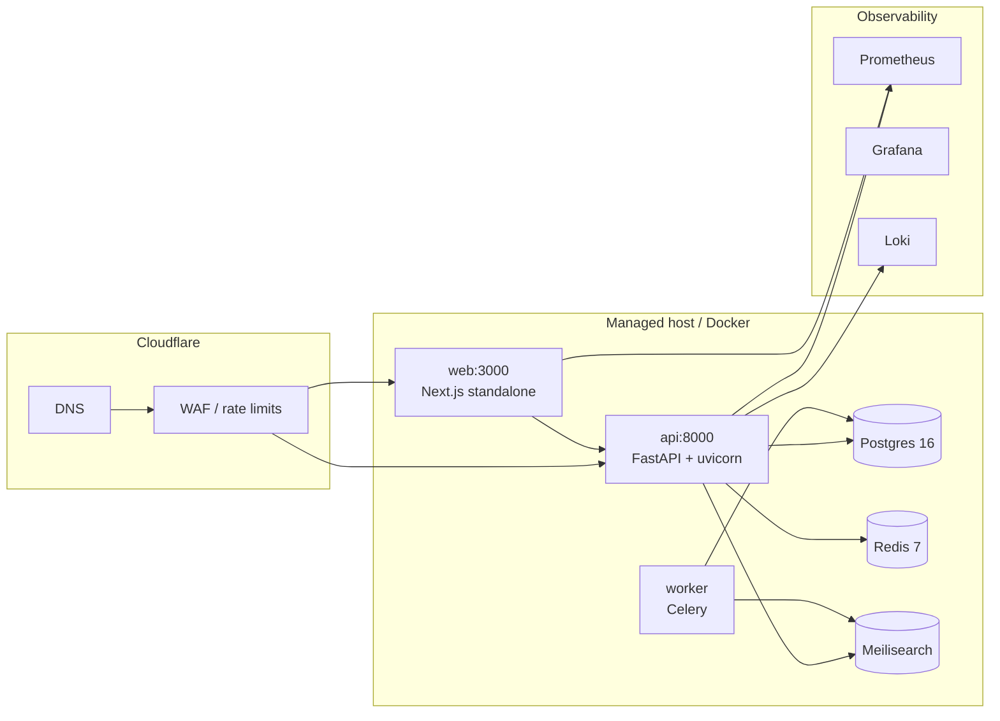
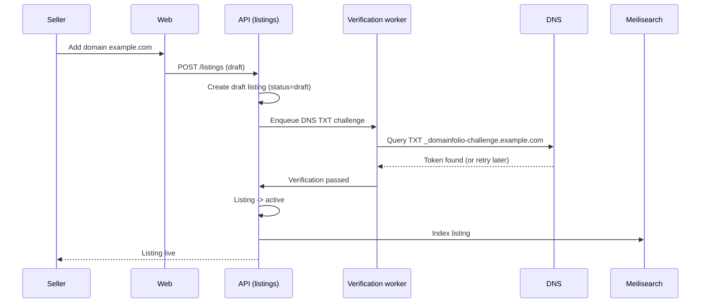
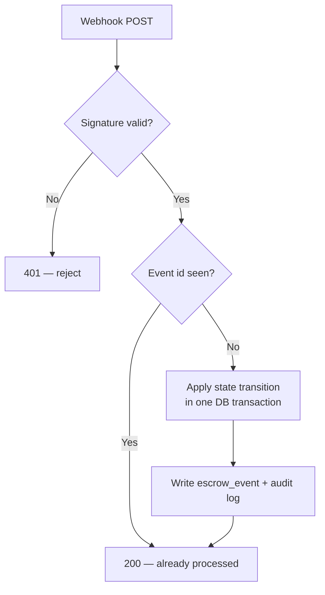

# DomainFolio — System Architecture (Option B)

| Field | Value |
|---|---|
| Status | **Phase 1 design — for Spencer's review.** |
| Basis | Phase 0 audit (`main` @ `6da17767`); `DOMAINFOLIO_MASTER_PLAN.md`. |
| Stack | Next.js 15 + TypeScript + Tailwind (web) · FastAPI (api) · PostgreSQL 16 · Meilisearch · Redis + Celery · Docker · GitHub Actions. |

## 1. Principles

1. **Modular monolith, strict boundaries.** One deployable API, but
   each bounded context is its own package with its own models,
   schemas, services, and routers. Cross-module calls go through the
   other module's service layer — never through its tables.
2. **The database is the source of truth; search is a read model.**
   Meilisearch is rebuilt from Postgres at any time. If search is
   down, listings still sell.
3. **Money flows are boring and explicit.** Escrow and billing are
   provider adapters + a state machine. No cleverness, no internal
   custody, no silent fallbacks.
4. **Fail closed.** Missing secrets, unverified signatures, and
   unverified listings all refuse — they never degrade to "allow".
5. **Everything auditable.** Every money or moderation action writes
   an audit-log row. Every commission rate is versioned.

## 2. System context



The existing lander app is **outside** this system until the cutover
decision (master plan §6). It keeps serving from `fedserv-snapshot`.

## 3. Deployment topology (staging / production)



- All service ports are loopback-only in Compose; public traffic
  arrives via Cloudflare Tunnel / edge (same pattern as the lander
  app). Admin services are never exposed publicly.
- Environments: `dev` (Compose, local) → `staging` (same Compose,
  separate host/data) → `production`. Same images, different env.
- Migrations run as a separate one-shot job (`alembic upgrade head`)
  before the new API starts — never implicitly at container start.
- Backups: nightly `pg_dump` + restore rehearsal (Stage 9 gate).

## 4. Module map (API)

```
apps/api/app/
  core/        config (env-only secrets), security (bcrypt, JWT)
  db/          engine/session, declarative base
  api/         shared deps: get_db, get_current_user
  modules/
    auth/          users, orgs, org_members, sessions, mfa, passkeys, RBAC
    listings/      domains, listings, portfolio, bulk import, landing pages
    verification/  dns challenges, tokens, re-verification, admin review
    search/        Meilisearch sync + query API
    offers/        offers, counteroffers, expiry, concurrency-safe accept
    escrow/        providers/ (base ABC, stub, escrow_com later),
                   webhooks (signature + idempotency)
    transfers/     transfer workflow, registrar instructions, evidence
    auctions/      auctions, bids, anti-sniping (P1)
    billing/       commission engine (versioned), Stripe (gated)
    admin/         moderation, disputes, fraud alerts, audit log
    ai/            valuations (estimates only), categorisation (P2)
  workers/       Celery app; tasks per queue (verification, escrow,
                   notifications, search sync)
```

Dependency rules:

- `routers` depend on `services`; `services` depend on `models` of
  their own module only.
- `escrow` and `billing` depend on `offers`/`transfers` service
  interfaces, not their tables.
- `search` reads from Postgres and writes to Meilisearch; nothing
  else writes to Meilisearch.
- `workers` call module services; they never contain business rules.

## 5. Request flows

### 5.1 Listing a domain (P0 happy path)



A listing is never `active` without a passed verification. Drafts are
invisible to search and buyers.

### 5.2 Buy Now / accepted offer → escrow (P0 happy path)

```mermaid
sequenceDiagram
    participant B as Buyer
    participant A as API (offers/escrow)
    participant P as Postgres
    participant E as Escrow provider
    participant T as Transfer workflow
    B->>A: Buy Now / accept offer
    A->>P: BEGIN; lock listing row (FOR UPDATE)
    P-->>A: Row locked; still available
    A->>P: Create transaction (status=created); listing -> reserved
    A->>P: COMMIT
    A->>E: Create escrow transaction (sandbox)
    E-->>A: provider_ref + status
    A->>P: Store provider_ref; status=payment_pending
    E-->>A: Webhook: payment secured (signed, deduped)
    A->>P: status=payment_secured (provider-confirmed only)
    A->>T: Start transfer workflow
    T-->>A: Buyer confirms receipt
    A->>E: Release / settle
    A->>P: status=settled; listing -> sold
```

Two concurrent Buy Now attempts: the second blocks on the row lock,
then sees `reserved` and fails cleanly — no double sale (Stage 6
concurrency test proves this).

### 5.3 Escrow webhook handling



No webhook secret configured → 503, never a silent accept. Replay of
the same event id changes state once.

## 6. Data flow summary

| Data | Write path | Read path |
|---|---|---|
| Users, listings, offers, transactions | API → Postgres | API → Postgres |
| Search index | Celery sync jobs → Meilisearch | API → Meilisearch |
| Verification state | Worker DNS checks → Postgres | API → Postgres |
| Escrow state | Provider webhooks → Postgres | API → Postgres |
| Files (uploads) | API → S3-compatible storage | Signed URLs |
| Audit log | Every money/moderation action → Postgres | Admin API |

## 7. Security architecture (summary — full doc in a later stage)

- **Auth:** email verification, TOTP MFA, WebAuthn passkeys, session
  records revocable server-side, RBAC enforced in services (not just
  routers). Admin MFA mandatory.
- **Transport:** TLS everywhere (Cloudflare edge); HSTS; security
  headers on every response (CSP, `X-Frame-Options`, `Referrer-Policy`).
- **Input:** Pydantic schemas on every endpoint; parameterized SQL
  only (SQLAlchemy); React escaping + CSP on the frontend.
- **Rate limiting:** Redis-backed, keyed on `CF-Connecting-IP`
  behind Cloudflare (the lander audit's spoofable-key finding is
  fixed here by design, not by patch).
- **Secrets:** env-only, no defaults, no secrets in the repo; webhook
  secrets per provider; auth codes never in ordinary logs.
- **Privacy:** Canadian requirements (PIPEDA / Quebec Law 25) are a
  Spencer/legal decision — no compliance claim is made here.
- **Backups:** nightly Postgres dumps + restore rehearsal; the audit's
  "no backup story" finding does not repeat in this system.

## 8. Observability

- **Metrics:** Prometheus via `prometheus-fastapi-instrumentator`
  (request latency, error rates, per-module counters); Celery task
  metrics; Postgres/Redis/Meilisearch health.
- **Logs:** structured JSON (structlog) to Loki; auth codes, tokens,
  and secrets are never logged.
- **Alerts (staging/prod):** error-rate spike, webhook failure streak,
  verification queue backlog, escrow sync lag, backup failure.
- **Health:** `/api/health` (liveness, checks nothing) and
  `/api/ready` (readiness — DB check lands with the first
  persistence-backed stage).

## 9. What is NOT in this architecture yet

- The 12 remaining Phase 17 docs (API spec, security architecture,
  domain verification, escrow integration, transfer workflow, auction
  engine, AI intelligence, deployment guide, test report, risk
  register, implementation status) — written with their stages.
- Staging/production host selection (Spencer decides, §8 of the
  master plan).
- The lander cutover design (§6 of the master plan).

---

*Architecture source: Phase 0 audit + master plan, Option B chosen
2026-11-23. Work dir: `~/workspace/domainfolio-monolith/`.*
